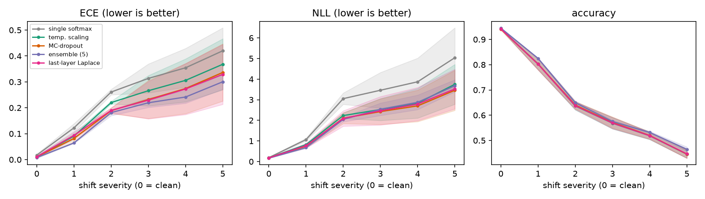
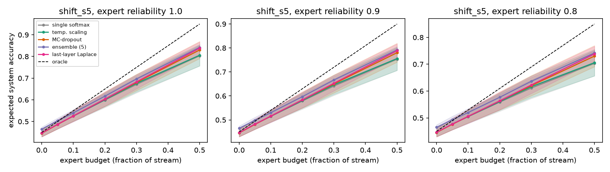
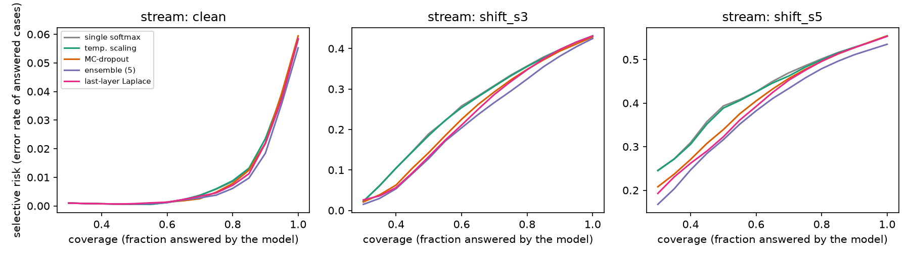

# Which uncertainty should decide when to ask the expert? Deferral under distribution shift (BloodMNIST)

A small, fully reproducible benchmark: five predictive-uncertainty methods (single softmax, temperature scaling, MC-dropout, a 5-member deep ensemble, a last-layer Laplace approximation written from scratch) on blood-cell images, evaluated under 25 controlled shifts and three out-of-distribution sets, and then used to decide **which cases a noisy human expert should look at** under a fixed review budget. 15 CNNs (3 seeds x 5 members), all numbers below are produced by the code in this repo and rendered into this file by `scripts/update_readme.py`.

Headline (3 seeds, mean ± std): under severe mixed shift (severity 5) every method is badly overconfident (ECE 0.30 to 0.42 against 0.008 to 0.017 on clean data). The deep ensemble is the best deferral policy at equal expert workload (about +1.5 points of system accuracy over a single softmax at a 10 % budget, on both severity-3 and severity-5 streams); temperature scaling improves calibration but leaves the *ranking* of cases almost unchanged, so it does not help deferral at a fixed budget; and on the near-OOD skin images the confidence-based scores are *below chance* (AUROC < 0.5) for all methods except the Laplace mutual-information score.

**Context.** The Kaski group's ERC project ODD-ML (Out-of-Distribution Deployable Machine Learning, grant 101201120) asks how to deploy models safely outside the training distribution with a domain expert in the loop at minimal workload. Recent group papers study adaptation to out-of-distribution tasks with noisy expert feedback [1] and human-machine collaboration for generalisation under distribution shift [2]. This repo is a small, independent, much simpler testbed for the *deployment-time* half of that question: when the model meets shifted data, which uncertainty signal should route cases to a fallible expert? It does not reproduce or extend those papers' methods.

## Question
Given a CNN trained on clean BloodMNIST, and an expert who answers correctly with probability r and can review a fraction b of the incoming stream, which uncertainty estimate (a) stays calibrated under shift, (b) detects OOD inputs, and (c) yields the highest expected system accuracy when it chooses what to defer?

## Data
[MedMNIST v2](https://arxiv.org/abs/2110.14795) (Zenodo record 10519652, CC BY 4.0 for these sets; no login): **BloodMNIST** (8 classes, 28x28 RGB, 11,959 train / 1,712 val / 3,421 test) is the in-distribution task. Near-OOD sets: **DermaMNIST** test (skin lesions, 2,005 images) and **OrganAMNIST** test (abdominal CT slices, grayscale replicated to 3 channels, 3,421 randomly drawn). Far-OOD control: 3,421 uniform-noise images. Total download about 93 MB (`make data`); data is never committed. Shifts are applied to the BloodMNIST test set only: Gaussian noise, Gaussian blur, brightness, contrast and pixelation at five severities each (`src/expert_deferral/data.py`, parameters fixed in code), plus a *mixed stream* in which every image gets one randomly chosen corruption at a given severity.

## Method
- **Model.** One small CNN (2 conv blocks, 128-d penultimate layer, dropout), AdamW + one-cycle, 20 epochs, checkpoint with best clean validation NLL. Seeds 0, 1, 2; five members per seed.
- **Methods.** *single softmax* (member 0); *temperature scaling* (one temperature fitted on the clean validation set); *MC-dropout* (30 stochastic passes of member 0, all dropout layers active); *deep ensemble* (5 members); *last-layer Laplace* (full generalised Gauss-Newton Hessian over the 8x129 head weights, prior precision chosen on clean validation NLL, 200 sampled logit vectors; implemented in `laplace.py` and unit-tested against the autograd Hessian). Nothing is tuned on shifted data.
- **Metrics (own code, `metrics.py`).** ECE (15 equal-width bins), NLL, accuracy, AURC (area under the risk-coverage curve, uncertainty = predictive entropy), OOD AUROC with max-probability, entropy and mutual-information scores (OOD is the positive class; AUROC below 0.5 means OOD inputs looked *more* certain than in-distribution ones).
- **Expert simulation.** Expected system accuracy when the b most uncertain cases go to an expert who is right with probability r (their errors count as errors), against random deferral and an oracle that reviews the model's errors first. A second policy defers whenever the model's top probability is below r (optimal if probabilities are calibrated).

## Results
All tables: mean ± std over 3 seeds.

### Calibration, accuracy and selective risk under shift
<!-- table:calibration -->
| method | condition | accuracy | ECE ↓ | NLL ↓ | AURC ↓ |
|---|---|---|---|---|---|
| single softmax | clean test | 0.942 ± 0.002 | 0.017 ± 0.004 | 0.191 ± 0.010 | 0.008 ± 0.000 |
| temperature scaling | clean test | 0.942 ± 0.002 | 0.010 ± 0.002 | 0.180 ± 0.008 | 0.008 ± 0.000 |
| MC-dropout (30) | clean test | 0.941 ± 0.004 | 0.010 ± 0.004 | 0.179 ± 0.007 | 0.008 ± 0.001 |
| deep ensemble (5) | clean test | 0.945 ± 0.001 | 0.008 ± 0.003 | 0.165 ± 0.003 | 0.007 ± 0.000 |
| last-layer Laplace | clean test | 0.942 ± 0.002 | 0.011 ± 0.003 | 0.180 ± 0.009 | 0.007 ± 0.001 |
| single softmax | mixed shift, severity 3 | 0.569 ± 0.023 | 0.314 ± 0.056 | 3.460 ± 0.864 | 0.185 ± 0.027 |
| temperature scaling | mixed shift, severity 3 | 0.569 ± 0.023 | 0.266 ± 0.059 | 2.526 ± 0.532 | 0.184 ± 0.027 |
| MC-dropout (30) | mixed shift, severity 3 | 0.571 ± 0.022 | 0.232 ± 0.073 | 2.424 ± 0.621 | 0.171 ± 0.025 |
| deep ensemble (5) | mixed shift, severity 3 | 0.575 ± 0.005 | 0.219 ± 0.018 | 2.539 ± 0.301 | 0.159 ± 0.005 |
| last-layer Laplace | mixed shift, severity 3 | 0.569 ± 0.022 | 0.229 ± 0.072 | 2.465 ± 0.690 | 0.168 ± 0.025 |
| single softmax | mixed shift, severity 5 | 0.446 ± 0.016 | 0.420 ± 0.089 | 5.038 ± 1.451 | 0.351 ± 0.066 |
| temperature scaling | mixed shift, severity 5 | 0.446 ± 0.016 | 0.368 ± 0.099 | 3.749 ± 0.966 | 0.349 ± 0.066 |
| MC-dropout (30) | mixed shift, severity 5 | 0.446 ± 0.016 | 0.336 ± 0.110 | 3.458 ± 0.974 | 0.328 ± 0.057 |
| deep ensemble (5) | mixed shift, severity 5 | 0.465 ± 0.010 | 0.300 ± 0.029 | 3.680 ± 0.292 | 0.300 ± 0.013 |
| last-layer Laplace | mixed shift, severity 5 | 0.447 ± 0.017 | 0.329 ± 0.116 | 3.518 ± 0.961 | 0.325 ± 0.043 |
<!-- /table:calibration -->



### OOD detection (AUROC, in-distribution = clean BloodMNIST test)
<!-- table:ood -->
| method | score | near-OOD: DermaMNIST | near-OOD: OrganAMNIST | far-OOD: uniform noise |
|---|---|---|---|---|
| single softmax | max_prob | 0.267 ± 0.024 | 0.615 ± 0.118 | 0.250 ± 0.063 |
| single softmax | entropy | 0.151 ± 0.030 | 0.611 ± 0.132 | 0.183 ± 0.119 |
| temperature scaling | max_prob | 0.210 ± 0.011 | 0.610 ± 0.132 | 0.201 ± 0.106 |
| temperature scaling | entropy | 0.150 ± 0.029 | 0.605 ± 0.134 | 0.182 ± 0.119 |
| MC-dropout (30) | max_prob | 0.267 ± 0.047 | 0.903 ± 0.028 | 0.364 ± 0.146 |
| MC-dropout (30) | entropy | 0.235 ± 0.055 | 0.906 ± 0.032 | 0.359 ± 0.153 |
| MC-dropout (30) | mutual_info | 0.262 ± 0.060 | 0.975 ± 0.015 | 0.398 ± 0.168 |
| deep ensemble (5) | max_prob | 0.360 ± 0.011 | 0.917 ± 0.010 | 0.481 ± 0.211 |
| deep ensemble (5) | entropy | 0.271 ± 0.015 | 0.911 ± 0.012 | 0.471 ± 0.219 |
| deep ensemble (5) | mutual_info | 0.310 ± 0.015 | 0.972 ± 0.009 | 0.518 ± 0.249 |
| last-layer Laplace | max_prob | 0.442 ± 0.063 | 0.939 ± 0.027 | 0.579 ± 0.097 |
| last-layer Laplace | entropy | 0.432 ± 0.065 | 0.950 ± 0.031 | 0.581 ± 0.100 |
| last-layer Laplace | mutual_info | 0.517 ± 0.069 | 0.994 ± 0.005 | 0.702 ± 0.110 |
<!-- /table:ood -->

### Deferral at equal expert workload (expert reliability r = 0.9)
<!-- table:deferral -->
| stream | expert budget | no expert | random deferral | single softmax | temperature scaling | MC-dropout (30) | deep ensemble (5) | last-layer Laplace | oracle |
|---|---|---|---|---|---|---|---|---|---|
| clean | 10 % | 0.942 | 0.938 | 0.970 ± 0.001 | 0.969 ± 0.001 | 0.970 ± 0.001 | **0.973 ± 0.001** | 0.970 ± 0.001 | 0.990 |
| clean | 20 % | 0.942 | 0.933 | 0.973 ± 0.000 | 0.973 ± 0.001 | 0.974 ± 0.000 | **0.975 ± 0.001** | 0.974 ± 0.001 | 0.980 |
| shift_s3 | 10 % | 0.569 | 0.602 | 0.632 ± 0.026 | 0.632 ± 0.028 | 0.636 ± 0.031 | **0.647 ± 0.005** | 0.632 ± 0.032 | 0.661 |
| shift_s3 | 20 % | 0.569 | 0.635 | 0.695 ± 0.029 | 0.695 ± 0.028 | 0.701 ± 0.033 | **0.720 ± 0.004** | 0.702 ± 0.030 | 0.750 |
| shift_s5 | 10 % | 0.446 | 0.491 | 0.515 ± 0.025 | 0.515 ± 0.024 | 0.516 ± 0.024 | **0.530 ± 0.015** | 0.516 ± 0.026 | 0.540 |
| shift_s5 | 20 % | 0.446 | 0.537 | 0.579 ± 0.034 | 0.581 ± 0.032 | 0.583 ± 0.034 | **0.597 ± 0.011** | 0.583 ± 0.032 | 0.630 |
<!-- /table:deferral -->





### Threshold policy "defer if top probability < r" on the severity-5 stream
Here methods differ in workload, so system accuracy is not comparable across rows without looking at the deferred share.
<!-- table:threshold -->
| method | r = 0.8: system acc / deferred | r = 0.9: system acc / deferred | r = 0.95: system acc / deferred | r = 1.0: system acc / deferred |
|---|---|---|---|---|
| single softmax | 0.604 / 28 % | 0.676 / 36 % | 0.734 / 42 % | 0.979 / 88 % |
| temperature scaling | 0.643 / 36 % | 0.753 / 49 % | 0.829 / 58 % | 0.989 / 93 % |
| MC-dropout (30) | 0.687 / 43 % | 0.785 / 54 % | 0.872 / 64 % | 0.996 / 96 % |
| deep ensemble (5) | 0.751 / 52 % | 0.857 / 63 % | 0.909 / 69 % | 0.995 / 92 % |
| last-layer Laplace | 0.684 / 42 % | 0.793 / 53 % | 0.883 / 64 % | 0.998 / 98 % |
<!-- /table:threshold -->

### Ensemble size (clean / severity-5 mixed stream)
<!-- table:ensemble -->
| members | ECE clean | ECE shift 5 | NLL shift 5 | AURC clean | AURC shift 5 |
|---|---|---|---|---|---|
| 1 | 0.017 ± 0.004 | 0.420 ± 0.089 | 5.038 ± 1.451 | 0.008 ± 0.000 | 0.351 ± 0.066 |
| 2 | 0.012 ± 0.005 | 0.367 ± 0.083 | 4.440 ± 0.948 | 0.007 ± 0.000 | 0.335 ± 0.038 |
| 3 | 0.008 ± 0.001 | 0.325 ± 0.058 | 4.048 ± 0.435 | 0.007 ± 0.000 | 0.316 ± 0.016 |
| 4 | 0.009 ± 0.001 | 0.335 ± 0.033 | 3.813 ± 0.172 | 0.007 ± 0.000 | 0.315 ± 0.006 |
| 5 | 0.008 ± 0.003 | 0.300 ± 0.029 | 3.680 ± 0.292 | 0.007 ± 0.000 | 0.300 ± 0.013 |
<!-- /table:ensemble -->

### Setup actually used
<!-- table:setup -->
- 15 CNNs (3 seeds x 5 members), mean clean test accuracy 0.937, 29 s per model on `mps`.
- Fitted temperatures per seed: 1.45, 1.45, 1.37. Laplace prior precision chosen on clean validation NLL per seed: 100, 100, 100.
- Software: torch 2.15.0 on arm64.
<!-- /table:setup -->

## What I learned
- The severe shifts are *harsh*: accuracy falls from about 0.94 to 0.57 (severity 3) and 0.45 (severity 5), and all methods stay overconfident. Ensembles, MC-dropout and Laplace lower the severity-5 ECE by about 20 to 30 % compared with a single softmax, none of them closes the gap.
- Calibration is not ranking. Temperature scaling lowers ECE and NLL but, as an almost order-preserving rescaling, leaves the ordering of cases (and hence AURC and fixed-budget deferral) nearly identical to the plain softmax; only methods with a different ordering signal (ensemble, a little MC-dropout and Laplace) gain at equal workload.
- With probabilities that are honest, a threshold rule is the sensible policy, and the table shows why calibration matters for it: the overconfident single softmax defers only 36 % at r = 0.9 on the severity-5 stream while a 5-member ensemble defers 63 % and ends 18 points higher in system accuracy; the cost is expert workload, which is exactly the trade-off the ODD-ML framing is about.
- Max-probability OOD detection is unreliable on this task: for the softmax, MC-dropout and ensemble, skin-lesion and noise images often get *more* confident predictions than clean blood cells (AUROC below 0.5), while mutual-information scores that use epistemic spread work well on the CT set (0.97 to 0.99) and the Laplace score is the only one above chance on all three sets. That is a reminder that "uncertain" and "out of distribution" are different things.
- The gap to the oracle stays large (for example 0.597 against 0.630 at a 20 % budget on severity 5 for the best method), so there is clear room for methods that use the expert's answers, which is where the group's human-in-the-loop work sits.

## Limitations
- Synthetic shifts on a 28x28 benchmark and a small CNN; conclusions may not transfer to larger images or pretrained models. The mixed severity-3/5 streams are harsh by design.
- Only three seeds; stds are sample stds over seeds, no significance tests.
- The expert is a constant-reliability simulation whose errors are not modelled further; real experts are less reliable on exactly the hard, shifted cases (the setting of [2]). Expert cost is only counted as the fraction of cases reviewed.
- No tuning of dropout rate, ensemble diversity, or Laplace prior beyond a six-value grid on clean validation NLL; Laplace is last-layer only and the model was not trained with a matching prior.
- ECE depends on binning; NLL and Brier are in the raw JSON. DermaMNIST is a different task with a different resolution/colour distribution from BloodMNIST, so near-OOD here is easy to confuse with a covariate shift.
- Unrelated to any clinical use.

## Reproduce
```bash
make venv && make data && make train && make eval && make figures && make readme
make test
```
Measured on an Apple M3 Pro (MPS): training about 29 s per CNN (about 7 min for all 15), evaluation about 100 s per seed.

## References
1. L. Mäkinen, J. Loría, S. Kaski. Bayesian Meta-Learning with Expert Feedback for Task-Shift Adaptation through Causal Embeddings. ICML 2026. arXiv:2602.19788.
2. M. Parakkal Unni, S. Kaski. Human-Machine Collaboration on Generative Meta-Learning: Model and Algorithm. arXiv:2607.00926.
3. ERC project ODD-ML, Out-of-Distribution Deployable Machine Learning, CORDIS grant 101201120. https://cordis.europa.eu/project/id/101201120
4. J. Yang et al. MedMNIST v2. arXiv:2110.14795.
5. C. Guo, G. Pleiss, Y. Sun, K. Weinberger. On Calibration of Modern Neural Networks. arXiv:1706.04599.
6. B. Lakshminarayanan, A. Pritzel, C. Blundell. Simple and Scalable Predictive Uncertainty Estimation using Deep Ensembles. arXiv:1612.01474.
7. Y. Gal, Z. Ghahramani. Dropout as a Bayesian Approximation. arXiv:1506.02142.
8. E. Daxberger et al. Laplace Redux. arXiv:2106.14806.
9. A. Kristiadi, M. Hein, P. Hennig. Being Bayesian, Even Just a Bit, Fixes Overconfidence in ReLU Networks. arXiv:2002.10118.
10. Y. Ovadia et al. Can You Trust Your Model's Uncertainty? Evaluating Predictive Uncertainty Under Dataset Shift. arXiv:1906.02530.
11. D. Hendrycks, K. Gimpel. A Baseline for Detecting Misclassified and Out-of-Distribution Examples. arXiv:1610.02136.
12. D. Hendrycks, T. Dietterich. Benchmarking Neural Network Robustness to Common Corruptions and Perturbations. arXiv:1903.12261.
13. Y. Geifman, R. El-Yaniv. Selective Classification for Deep Neural Networks. arXiv:1705.08500.
14. H. Mozannar, D. Sontag. Consistent Estimators for Learning to Defer to an Expert. arXiv:2006.01862.

(I read the abstracts of [1], [2] and the other arXiv entries through the arXiv API; the summaries of their contributions above are limited to what those abstracts state.)

## Licence
MIT. Code by Maryam Tavasoli (ORCID 0009-0006-3535-4724). Data: MedMNIST v2 (CC BY 4.0), see its license notes.
